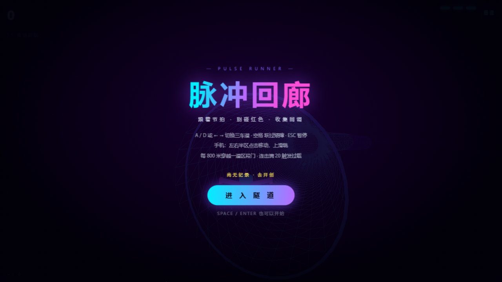
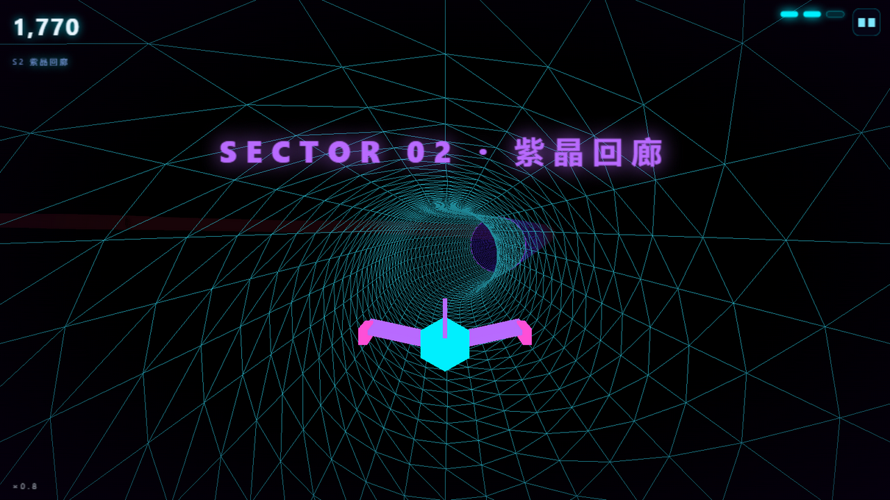
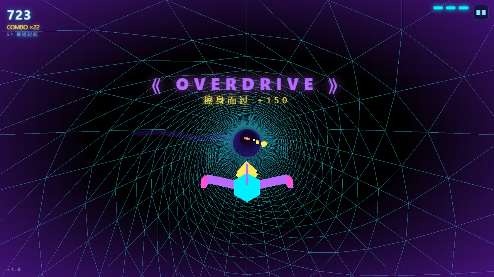
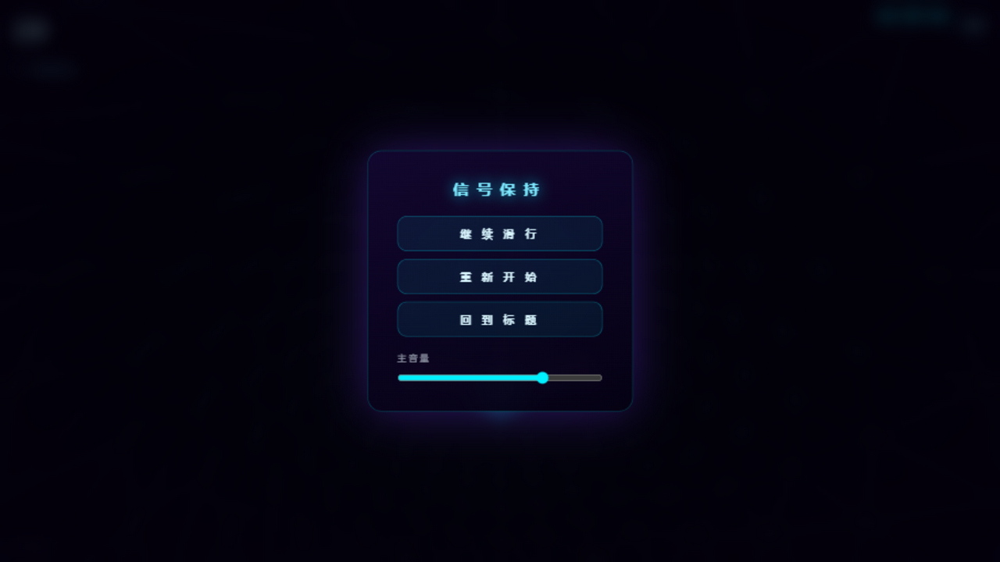

# 脉冲回廊 · PULSE RUNNER

纯代码 synthwave 霓虹隧道节奏跑酷。一条不断生长的发光轨道，速度只会越来越快——跟着节拍切车道、跳过矮障、读准扫描闸的时机，把黄色的能量块串成连击，连击满 20 触发 8 秒 OVERDRIVE 过载，每 800 米穿越一道区段门进入更深主题的回廊。

- **A / D 或 ← →** 切三车道，**空格** 跃过矮障（高杆必须绕），**ESC / P** 暂停
- 手机：**左右半区**点击移动，**上半屏**上滑跳，右上角 **▮▮** 暂停
- 连吃能量块攒 COMBO，倍率每 5 连击上一档；贴着障碍擦过 +150；撞红色碎一面护盾并减速，护盾归零信号中断
- 掉盾后能量串里有小概率混入**绿色回充棱镜**（+1 护盾，上限 3）
- **区段（SECTOR）**：每 800m 一道门，青锚起航 → 紫晶回廊 → 熔金峡谷 → 相位裂隙 → 无终超载，各区段色相主题、障碍配方、封锁密度与环境粒子（浮尘/上升火花/下落碎屑/闪烁电花）递进
- **OVERDRIVE**：连击满 20 一次性触发，8 秒得分翻倍 + 无敌 + BPM +8 + 隧道提亮
- 速度渐升，音乐 BPM 跟着速度一起加快——隧道的光环会踩着鼓点呼吸

## 实机画面

| 标题 · 回廊悬停 | SECTOR 02 · 紫晶回廊 |
| --- | --- |
|  |  |
|  |  |
| **OVERDRIVE 过载** | **暂停菜单** |

结算（距离 / 最大连击 / 擦身 / 抵达区段）见 `docs/screenshots/death-stats.png`。

## 运行

纯静态，无需构建。Windows 最省事：双击 `D:\zcode\projects\启动-脉冲回廊.bat`（自动起服务器并打开浏览器）。

或手动：

```bash
python serve.py 8000
# 打开 http://localhost:8000
```

（serve.py 带 no-cache 头，改代码刷新即生效；`python -m http.server` 也可以，但开发时会撞浏览器缓存。）

音频需要一次点击后才开始（浏览器规矩）。最高分与音量存在 localStorage。

## 测试

```bash
node test/logic.test.mjs
```

覆盖区段索引边界、色相范围、行配方（扫描闸单车道 / 车道数 ≤ maxBlocked / 任何一排不可能封死全部三车道 / 确定性回归），以及**分布统计**（各区段 kind 占比与权重一致 ±8pp、扫描闸密度逐段递增）。

## 性能实测

ZCode 内嵌浏览器（1280×720，`devicePixelRatio` 1.5 上限）实测：**84 FPS**，JS 堆 14–25MB（万米压力跑稳定，含 340 粒环境粒子层）。GPU 资源（geometry/material）在实体回收与轨道段回收时同步 dispose——行进中的 Tube 回收是最高频分配点。桌面独立 Chrome 全速 GPU 下帧率余量更大。

## 架构

ES 模块，单向依赖（`main` 编排一切，`ui` 只碰 DOM，业务回调由 main 注入避免环）：

| 模块 | 职责 |
| --- | --- |
| `js/core.js` | 工具函数与色相公式 |
| `js/state.js` | 唯一可变状态：`state` + `player` |
| `js/scene.js` | 渲染器 / 相机 / 雾 / 星野 / resize |
| `js/audio.js` | WebAudio 步进音序器（kick/hat/bass/arp）+ 全部音效 + BPM 同步 |
| `js/track.js` | 样条轨道生长、Tube 分段与回收、接缝发光环 |
| `js/entities.js` | 飞船 / 尾焰 / 三种障碍 / 能量块 / 区段门 / 爆裂粒子 |
| `js/ambience.js` | 区段专属环境粒子层（浮尘 / 火花 / 碎屑 / 电花） |
| `js/sectors.js` | 区段配置表与行计划（纯函数，可单测） |
| `js/ui.js` | HUD / 标题 / 暂停菜单 / 音量 / 结算 |
| `js/main.js` | 状态机、输入、生成、碰撞、区段推进、OVERDRIVE、主循环 |

调试：URL 加 `?debug=1` 暴露 `window.__pulse`（state / player / 实体数组）；rAF 内异常会转发到 `document.title`（LOOP ERR 前缀），开发期立刻可见。

## 纯代码清单

零资产文件（唯一依赖是 three.js 本体），一切程序生成：

- **轨道**：一条向前生长的 CatmullRom 样条（每 24 米一个控制点，按段弯折与俯仰），TubeGeometry 分段成管 + 线框霓虹层，接缝处挂发光环随鼓点呼吸；身后的旧段自动回收
- **色相**：区段主题色 + 深度流转，青紫起步 → 品红 → 金——尾焰颜色跟着轨道走
- **飞船**：六棱锥机头 + 双翼 + 背鳍纯几何拼装，变道会侧倾，引擎拖尾是加色混合的点精灵
- **节拍**：WebAudio 步进音序器实时合成 synthwave——正弦下扫 kick、噪声 hi-hat、滤波锯齿 bass、带延迟的方波琶音（Am–F–C–G 走向），无任何音频文件
- **粒子**：收集与撞击各自的颜色爆裂（加色混合点云 + 重力）
- **氛围**：指数雾随区段变色、节拍脉冲的发光环、屏幕渐晕、星野滚动、区段门 fov 冲击

## 已知问题

- 触控模式未经真机回归（逻辑与原版一致，仅新增暂停按钮）
- OVERDRIVE 结束瞬间节拍脉冲可能有一次轻微视觉跳变（排定节拍在音频时钟冻结期的残留）
